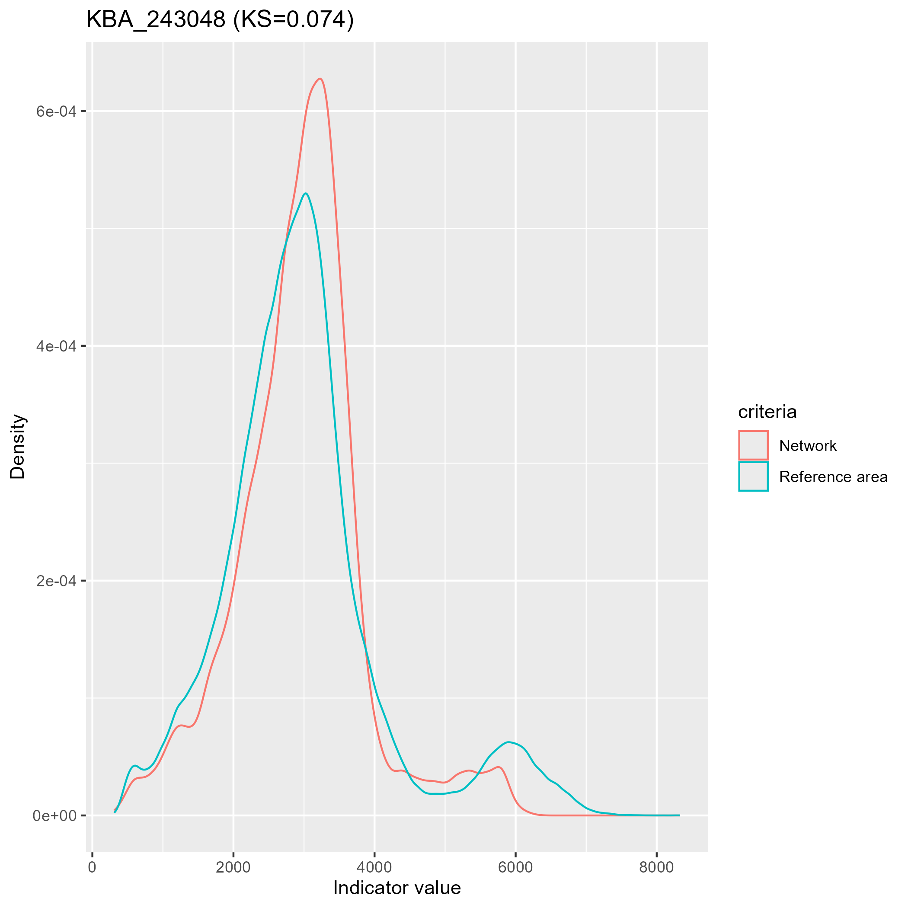
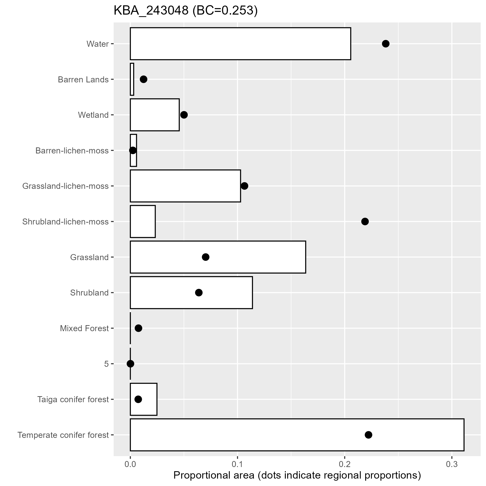

# KBA Analysis App: User Guide

<!-- Generated by docs/build_userguide.R on 2026-11-27. Do not edit: edit the *_doc.md files and rerun the script. -->

## Contents

- [Set input parameters](#set-input-parameters)
- [Add display elements (OPTIONAL)](#add-display-elements-optional)
- [Create Builder input](#create-builder-input)
- [Run Builder and calculate DCI](#run-builder-and-calculate-dci)
- [Reduce KBAs (OPTIONAL)](#reduce-kbas-optional)
- [Assess representation of KBAs and PAs](#assess-representation-of-kbas-and-pas)
- [Create Networks](#create-networks)
- [View previous analysis](#view-previous-analysis)
- [Download Results](#download-results)

---

## Set input parameters

Setting input parameters requires to: 

### 1. Select the output directory and project
1. Select an output directory:
   - Navigate to the directory where BenchmarkBuilder_cmd.exe is located.
   - Click Select (bottom right), then confirm your selection. 
2. Select the project type:
   - **Use an existing project**: pick a project (subfolder) from the list. Previously uploaded layers and results are reloaded automatically, so you can go to step 3.
   - **Create a new project**: enter a name. The app creates the project folder with the subfolders `data`, `output`, `Builder_input` and `Builder_output`.

&#x1F4CC; **Note:** Directory and project names must not contain spaces.

 

### 2. Upload spatial datasets
All spatial datasets for building KBAs are uploaded here, as well as the planning region boundary, protected areas, reference area for representation analysis, and environmental criteria for assessing representation (CMI, LCC, LED, and GPP). This includes shapefiles and TIF files. 

A shapefile consists of multiple files with the same name but different extensions. All files associated with the shapefile must be uploaded and must include .shp, .shx, .dbf, .prj. 

A tif is a single .tif file. 

All spatial datasets must have the same projectiong e.g., `NAD 1983 Albers`.

The following spatial datasets are required:   
- **Catchments**: A shapefile representing a set of watershed catchments created by BEACONs Project. 
- **Streams**: A shapefile of linear features representing the stream network. 
- **Planning region**: A single polygon outlining the boundary of the planning area where KBAs will be generated
- **LCC**: A TIF representing Land Cover map of Canada 2020 (categorical- 19 classes)  
- **LED**: A TIF representing Lake-Edge Density (continuous)  
- **CMI**: A TIF representing Climate Moisture Index (continuous)
- **GPP**: A TIF representing Gross Primary Productivity (continuous)

Optional spatial dataset: 
- **Protected areas**: A shapefile representing existing protected areas.
- **Reference area**: A polygon defining the area against which KBA representation will be assessed.
- **Custom criteria**: One additional spatial dataset for the representation analysis can be uploaded e.g., climate-projected CMI. The name of file will appear in the map legend, naming of output files, and as an attribute name in shapefile tables. As such, a short name is recommended e.g., projcmi. 

There are two options for uploading the spatial datasets: (1) use csv with file pathways and (2) upload individual layers. 

**OPTION 1: Use CSV with file pathways**

The spatial datasets can be uploaded using a csv file created in a text editor (e.g., Notepad). The csv file must have the following structure:

 Layer,Path  
 catchments,C:/data/catchments.shp  
 stream,C:/data/streams.shp  
 planning region,C:/data/planning_region.shp  
 protected areas,C:/data/protected_areas.shp **This dataset is optional. Delete this line if a protected areas dataset is not included.*  
 reference area,C:/data/reference_area.shp **This dataset is optional. Delete this line if a reference area dataset is not included.*  
 CMI,C:/data/cmi.tif  
 LCC,C:/data/lcc.tif  
 LED,C:/data/led.tif  
 GPP,C:/data/gpp.tif  
 PROJCMI,C:/data/projcmi.tif **Adding custom criteria is optional. Delete this line if a custom dataset is not included.* 

The column headings (Layer,Path) must not change. Layer names under the "Layer" column (e.g., catchments, streams, planning region, etc.) must not change except for the custom criteria (e.g., PROJCMI). See note above about naming the custom criteria under "Optional spatial dataset".

Template can be downloaded [here](./accessPath.csv)

**OPTION 2: Upload individual layers.**

Datasets are uploaded by navigating to the shapefile or tif, select the dataset, and click open. A shapefile consists of multiple files with the same name but different extensions. All files associated with the shapefile must be selected before clicking "Open".  

**Confirm the upload**

With either option, selecting the files does not load them yet. Click **Confirm upload**: the app reads every layer and checks, in this order:

1. all required layers are provided (catchments, streams, planning region, LCC, LED, GPP, CMI) and can be read;
2. the catchments contain the required columns (Isolated, length_m, FDA_M, Area_land, Area_water, Area_total, CATCHNUM, ORDER1, ORDER2, ORDER3, BASIN, SKELUID, STRAHLER);
3. all layers use the same projection.

If a check fails, a pop-up explains the problem and no layer is loaded. Fix the layers outside the app, select them again if needed, and click **Confirm upload** again. When all checks pass, the layers are drawn on the map and the intactness attribute can be selected.

 

### 3. Specify the intactness attribute

Select the catchment attribute giving the proportion of each catchment that is intact (0 to 1, where 1 = 100% intact). **This is required before using any other section.**

 

### 4. Protected areas (optional)
Once the intactness attribute is set, upload the protected areas here if they were not in the CSV. The app then automatically calculates, for each PA:

- **area_km2**: area of the PA
- **AWI**: area-weighted intactness of the PA (0–1)
- **up_km2** and **up_AWI**: area and intactness of the land upstream of the PA, using the same method as BUILDER
- **dci**: Dendritic Connectivity Index, from 0 (fragmented) to 1 (fully connected stream network within the PA) (Cote et al. 2009)

The results are shown on the map and in the **Protected areas statistics** table below it. Click a PA on the map to highlight its row. A `NAME` attribute is used for display. If it is missing, the table shows empty names.

This step is required to include PAs in **Assess representation** and in KBA networks.

 

### Output
Uploaded spatial datasets are copied to the project's data folder. When a CSV file is used, layer_paths.csv is also saved in this folder. 
This allows the project to be reopened later with the same input datasets.

---

## Add display elements (OPTIONAL)

Add up to **three vector layers** to the map as visual references, e.g., salmon spawning sites or critical mineral potential. These layers are **for display only**: they are not used in any analysis and are not saved to the project.

 

### Using the app
1. Under **Select source for extra layers**, choose **Shapefile** or **GeoPackage**.
2. Select up to three layers:
   - **Shapefile**: for each layer, browse to the shapefile and select all of its files (`.shp`, `.shx`, `.dbf`, `.prj`) before clicking **Open**.
   - **GeoPackage**: upload one GeoPackage, then pick up to three of its layers from the drop-down lists.
3. Click **Confirm**. The layers are drawn on the map and added to the layer control (top right), where they can be turned on or off.

 

### Notes and limitations
- **Supported geometries:** points, lines and polygons. Rasters are not supported.
- **Names:** the file name (Shapefile) or the layer name (GeoPackage, first 25 characters) is used as the display name. Short names are recommended.
- **Colors** are fixed by position (see the color box next to each layer) and cannot be changed:
  - Layer 1: orange
  - Layer 2: purple
  - Layer 3: dark teal
- **Projection:** any CRS is accepted. Layers are reprojected for display.
- Clicking **Confirm** again replaces the previously added display layers.
- Display layers are not kept when the app is reloaded or when a project is reopened.

 

### Output
None. Display layers are not written to the project folder or the GeoPackage.

---

## Create Builder input

Builder constructs KBAs by assembling catchments using hydrology-based rules, to a user-specified size and intactness. The construction of a 
KBA starts from a single 'seed' catchment. This step prepares the two tables BUILDER needs:

1. **Seed list** (i.e.; seed.csv): the catchments from which KBAs are built, each with an area target (m2). 
2. **Neighbours table** (i.e.; nghbrs.csv): each catchment and the catchments it touches.

The catchments table also required by BUILDER is created automatically in the next step (**Run Builder**).

&#x1F4CC; **Note:** The intactness attribute used here is the one selected in **Set input parameters**. 
The catchments layer must contain `CATCHNUM` and `STRAHLER`.

 

### Using the app

#### Option A: Use existing files

Upload a seed list and/or a neighbours table created earlier by the app or by BUILDER. Uploaded files are used as-is, and the 
corresponding **Create** settings are ignored. In this step, either upload or create the neighbours file and seed list. 

**Seed list**: one row per seed catchment:

| Column | Description | 	
|---|---|
| `CATCHNUM` | Catchment identifier, matching `CATCHNUM` in the catchments layer |
| `Areatarget` | Minimum KBA size to reach from this seed (m²) |

Use this option if seeds need different area targets.

**Neighbours table**: one row per pair of touching catchments:

| Column | Description |
|---|---|
| `CATCHNUM` | Catchment identifier |
| `neighbours` | Identifier of a catchment sharing at least one point with it |
| `key` | Row index starting at 0 |

&nbsp;

#### Option B: Create the seed list
If no seed list is uploaded, the app selects seed catchments from the catchments layer:

| Setting | Description | Default |
|---|---|---|
| **Specify intactness attribute** | Keep catchments with intactness ≥ this value | `0` |
| **Specify Strahler Order ≤** | Keep catchments with a stream order **equal to** this value (`1` = headwater catchments). We recommend starting with order 1, especially in highly intact landscapes. | `1` |
| **Specify area target (m2)** | Applied to every seed. For variable targets, upload a custom seed list (Option A). | `10,000,000,000` (10,000 km²) |
| **Constrain seeds to the reference area** | Keep only catchments lying entirely within the reference area. If no reference area is loaded yet, an upload box appears. | Off |

If no neighbours table is uploaded, the app creates one. Catchments are neighbours when they share at least one point.

 

#### Run
Click **Set Builder input**. Creating the neighbours table can take several minutes for large catchment datasets. When the step is complete, 
the button changes to **Builder input now set!**

Possible messages:
- **Seed intactness must be between 0-1**: correct the value and click again.
- **No seed catchment found**: no catchment meets the criteria. Lower the minimum intactness or change the Strahler order.

&#x1F4CC; **Note:** When an existing project is reopened, the saved `seeds.csv` and `nghbrs.csv` are reloaded automatically, and this step can be skipped.

 

### Output
Saved in the project's `Builder_input` folder:
- `seeds.csv`: seed list
- `nghbrs.csv`: neighbours table

---

## Run Builder and calculate DCI

This step runs BUILDER to construct candidate KBAs from the seed list and neighbours table, then calculates hydrology metrics (DCI, upstream 
area and upstrea area weigthed intactness) for each KBA. DCI (Dendritic Connectivity Index) quantifies the “longitudinal connectivity of 
river networks based on the expected probability of an organism being able to move freely between two random points of the network”, (Cote et al. 2009).

 

### Using the app

#### 1. Specify minimum intactness (0–1) 

Intactness ranges from 0 (0% intact) to 1 (100% intact).

- **Catchment-level**: minimum intactness for a catchment to be added to a KBA. For example, `0.8` means every catchment in the KBA
must be at least 80% intact.
- **KBA-level**: minimum area-weighted mean intactness of the whole KBA. For example, `0.9` means the KBA must be at least 90% intact.

Enter `0` at both levels to remove the influence of intactness. No catchment is then excluded, which maximizes hydrologic connectivity within KBAs. Default: `0` at both levels.
To remove the influence of intactness on the building process, enter 0 at both the catchment- and KBA-level. This will maximize hydrologic connectivity within the KBA because no catchments will be excluded due to intactness.

&nbsp;

#### 2. Specify area target type

Defines what BUILDER sums to decide when the seed's area target is reached:

- **landwater** (default): total area of the KBA.
- **land**: land area only. The KBA will be larger than the target because of its water area.
- **water**: water area only.

Next, identify the attributes in the catchment dataset that will be used for intactness, zone of construction, and area of land via dropdown menus.

&nbsp;

#### 3. Specify catchment attributes**  

- **Zone**: BUILDER does not build KBAs across zones. For example, if the planning region contains two watersheds with different zone 
values, no KBA will cross from one watershed to the other. `ZONE` is selected automatically if present. **A zone must be selected.**
- **Area land**: attribute used to track land area (default `Area_land`). It can be replaced by a custom measure. For example, to 
protect 1,000 km² of caribou habitat, select a `caribou_m2` attribute, choose area target type **land**, and set the seeds' area target 
to 1,000,000,000 m².

Finally, click the "Run Builder" button to start the construction process, which proceeds as follows:  

First, the App will check to see if Builder output files already exist in the subfolder called "Builder_output". If present, the App will automatically upload these files into the R environment, making them immediately available for use. If the parameters for running Builder have changed, a new destination folder needs to be set in order for Builder to run OR the files need to be deleted from the subfolder "Builder_output". 

Second, if there are no files in the "Builder_output" folder, the App will launch Builder, and files will be written to "Builder_output".  

 

### Run

Click **Run Builder**. The app:

1. Runs BUILDER. Output tables are written to `Builder_output`, prefixed with the run's date and time. The button changes to 
**Builder output created!**
2. Converts the KBAs to polygons and maps them as **Potential KBAs**.
3. Adds hydrology metrics to each KBA and calculates DCI. A progress bar is shown during this step.

The table under the map shows the number of KBAs created.

&#x1F4CC; **Note:** Each click runs BUILDER again. The app always uses the most recent output in `Builder_output`.

 

### KBA attributes
| Attribute | Description |
|---|---|
| `network` | KBA identifier (e.g., KBA_1) |
| `area_km2` | KBA area (km²) |
| `AWI` | Area-weighted mean intactness of the KBA (0–1) |
| `up_km2` | Area upstream of the KBA (km²) |
| `up_AWI` | Area-weighted mean intactness of the upstream area (0–1) |
| `dci` | Dendritic Connectivity Index: 0 = fragmented, 1 = fully connected stream network within the KBA (Cote et al. 2009) |

 

### Output
- **`Builder_output` folder**: BUILDER tables, prefixed with the run's date and time. Those used by the app are:
  - `*_COLUMN_All_Unique_BAs.csv`: all unique KBAs, one column per KBA. Row 1 is the KBA identifier, and the following rows list its catchments. Used to create the KBA polygons.
  - `*_Unique_BAs_attributes.csv`: area and intactness (AWI) of each KBA.
  - `*_HYDROLOGY_METRICS.csv`: upstream area and upstream intactness of each KBA.
  - `*_ROW_UPSTREAM_CATCHMENTS.csv`: list of catchment that form the upstream per KBA.
- **`output/KBA_analysis.gpkg`**:
  - `KBAs_builder`: KBA polygons as built by BUILDER
  - `upstream_KBAs`: upstream area of each KBA
  - `KBAs_reducedFALSE`: KBA polygons with all the attributes above. This layer is used in the next steps.

*Cote, D., Kehler, D.G., Bourne, C. et al. (2009). A new measure of longitudinal connectivity for stream networks. Landscape Ecol 24, 101–113.*

---

## Reduce KBAs (OPTIONAL)

Depending on the seed list and the size of the planning region, BUILDER can produce tens to thousands of KBAs, many of them spatially 
similar. This step groups similar KBAs and keeps only the best one in each group, which greatly speeds up the representation and network 
analyses.

You can skip this step: **Assess representation** can also use all KBAs (layer `KBAs_reducedFALSE`).

 

### How KBAs are reduced

A grid covering the KBAs is created, and each KBA is assigned to the grid cell containing its centroid. The smaller the cell, the more 
similar the KBAs within a group. A 10,000 m × 10,000 m cell works well in most cases, but other sizes are worth exploring. Within each group,
KBAs are ranked by:
   1. **DCI**, highest first (best internal hydrologic connectivity)
   2. **Upstream area**, smallest first
   3. **Upstream intactness (up_AWI)**, highest first

The top-ranked KBA of each group is kept.

 

### Using the app

1. When you open this tab, the KBAs created in **Run Builder and calculate DCI** are loaded. The table under the map shows their number.
2. Enter the **grid cell size** in metres (default `10000`, i.e. a 10 km × 10 km cell) and click **Run**. The reduced KBAs are displayed 
as **Potential KBAs (reduced)**, and the table shows the number kept.
3. To compare, change the grid size and click **Run** again.
4. Click **Save reduced KBAs in GPKG** to keep the result. **Only saved reductions are available in the next steps.**

&#x1F4CC; **Note:** If a reduction with the same grid size was already saved, it is reloaded instead of recalculated.

### Output

Added to `output/KBA_analysis.gpkg` when you click **Save**:
- `KBAs_reduced<grid size>` (e.g., `KBAs_reduced10000`): the reduced KBAs, with the same attributes as `KBAs_reducedFALSE` (`network`, `area_km2`, `AWI`, `up_km2`, `up_AWI`, `dci`) plus `group_id`, the grid cell of each KBA.

The removed KBAs remain available in `KBAs_reducedFALSE` (all KBAs with metrics) and `KBAs_builder`.

---

## Assess representation of KBAs and PAs

KBAs and PAs are assessed on how well they represent the environmental variation of a **reference area**, using four indicators that serve 
as surrogates for biodiversity: climate moisture (CMI), gross primary productivity (GPP), lake-edge density (LED) and land cover (LCC). 
An optional fifth, custom indicator can be added in **Set input parameters**. See the **Dataset Requirements** tab for descriptions.

The reference area may differ from the planning region. For example, KBAs may be built within an ecoregion plus its intersecting watersheds (planning region), 
while representation is measured against the ecoregion only (reference area).

### Dissimilarity metrics (DMs)
For each indicator, the distribution of pixel values within a KBA or PA is compared with the distribution within the reference area:
- **Kolmogorov–Smirnov (KS)** for continuous indicators (CMI, GPP, LED and the custom indicator)
- **Bray–Curtis (BC)** for land cover (LCC)

Both range from **0** (identical distributions, perfect proportional representation) to **1** (completely different). The lower the value,
the more representative the KBA or PA.

 

 

**Figure 1.** For continuous indicators (e.g., CMI), density plots show the distribution of the indicator within the KBA or PA (red) and within the reference area (blue). The Kolmogorov‐Smirnov (KS) statistic describes the dissimilarity between these distributions, and ranges in value from 0 to 1, where 0 indicates perfect proportional representation within the KBA or PA. Portions of the KBA or PA distribution (red) that fall below the blue represent values for which proportional representation was not achieved.

 

 

**Figure 2.** For categorical indicators (e.g., landcover), barplots show the proportions of each indicator class (i.e., land cover types) within the KBA or PA (bars) and within the reference area (black dots). The Bray‐Curtis (BC) statistic describes the dissimilarity between the bars and dots, and ranges in value from 0 to 1, where 0 indicates perfect proportional representation within the KBA or PA. Bars that fall below the black dots indicate that proportional representation of that class was not achieved. 

 

### Using the app

1. **Select the potential KBAs layer**: `KBAs_reducedFALSE` (all KBAs) or a saved reduction such as `KBAs_reduced10000`.
2. **Reference area**: upload it here if it was not provided in **Set input parameters**. Select all of the shapefile's
files (`.shp`, `.shx`, `.dbf`, `.prj`).
3. **Assess representation using**: **Only KBAs**, **Only PAs** or **Both KBAs and PAs**. The PA options are greyed out when no protected
areas were provided in **Set input parameters**.
4. Click **Run representation analysis**. The app:
   - clips each indicator raster to the reference area (done once per project)
   - calculates the DMs for every KBA and/or PA, with a progress bar
   - displays the indicator rasters and their legends on the map (toggle them in the layer control, top right)

   This can take a while, depending on the number of KBAs/PAs and the raster resolution. Results already calculated for the same layer are reloaded instead of recalculated.

5. **Explore**: choose a KBA or PA in **Select KBAs/PAs** (top right). It is highlighted on the map with its upstream area, a summary table 
is shown, and the indicator plots appear below the map. Click the expand icon to enlarge a plot.
6. **Filter**: set the maximum DM for each indicator, the **maximum upstream area** and the **minimum PA area** (applies to PAs only), 
then click **Apply filtering**. The map, counts table and **Select KBAs/PAs** list are restricted to the KBAs/PAs that pass all thresholds.
7. **Download Filtered KBAs**: saves the filtered set to the GeoPackage and copies its plots (see Output).

 

### Summary table
| Variable | Description |
|---|---|
| Area km2 | Area of the KBA/PA |
| AWI (%) | Area-weighted intactness of the KBA/PA |
| Upstream area km2 | Area upstream of the KBA/PA |
| Upstream AWI (%) | Area-weighted intactness of the upstream area |
| DCI | Dendritic Connectivity Index (0–1) 0 = fragmented, 1 = fully connected stream network within the KBA (Cote et al. 2009) |
| CMI, GPP, LED, *custom* | KS statistic (0–1) 0 = low dissimilarity or high representation, 1 = high dissimilarity or low representation | 
| LCC | BC statistic (0–1)  0 = low dissimilarity or high representation, 1 = high dissimilarity or low representation |

 

### Output
In `output/KBA_analysis.gpkg`:
- `repKBAs_reduced<grid>`: KBAs with DMs (Only KBAs or Both)
- `repPAs`: PAs with DMs (Only PAs or Both)
- `repKBAPAs_reduced<grid>`: KBAs and PAs combined (Both)
- Filtered sets saved with **Download**, named after the thresholds, e.g. `repKBAs_reduced10000_up25000_cmi0.2_gpp0.2_led0.2_lcc0.2`

Attributes: `network`, `area_km2`, `AWI`, `up_km2`, `up_AWI`, `dci`, `cmi`, `gpp`, `led`, `lcc` and the custom indicator, if used.

In the `output` folder:
- `kba_cmi.tif`, `kba_gpp.tif`, `kba_led.tif`, `kba_lcc.tif` (+ `_4326` display versions): indicator rasters clipped to the reference area
- `plot/<layer name>/<indicator>/<KBA or PA>.png`: distribution plots for each KBA/PA

&nbsp;

&#x1F4CC; **Note:** Clipped rasters and representation layers are reused when the project is reopened. If you change the reference area or the indicators, delete them first so they are recalculated.

---

## Create Networks

A single KBA or PA may not represent the reference area well enough. This step combines several KBAs (and optionally all protected areas) 
into **networks**, then assesses the representation of each network as a whole, using the same indicators and dissimilarity metrics as 
**Assess single KBAs**.

 

### How networks are built
- Every combination of *n* KBAs from the selected layer is created. For example, 3 KBAs taken 2 at a time gives 3 networks: KBA_1 + KBA_2, 
KBA_1 + KBA_3 and KBA_2 + KBA_3.
- Combinations containing **overlapping KBAs** are discarded.
- If **Include all PAs in the network** is checked, all protected areas are added to every network.
- Each network is assessed as one unit. Its area, intactness, upstream area and dissimilarity metrics are calculated for all its parts 
together.

&nbsp;

&#x1F4CC; **Note:** The number of combinations grows very quickly. For example, 50 KBAs give 1,225 networks of 2 and 19,600 networks of 3. 
Reduce the number of KBAs first (**Reduce KBAs**), and start with 2 KBAs per network.

 

1. **Select KBA Layer**: the KBAs to combine, either `KBAs_reducedFALSE` (all KBAs) or a saved reduction such as `KBAs_reduced10000`.
2. **Set number of potential KBAs per network**: minimum 2, and no more than the number of KBAs in the layer.
3. **Include all PAs in the network** (optional; shown only when protected areas were provided in **Set input parameters**).
4. Click **Build network**. The app builds the networks, calculates their metrics with a progress bar, and displays the indicator rasters on the map. This can take a long time when there are many combinations. Networks already built with the same settings are reloaded instead of recalculated.
5. **Explore**: choose a network in **Select network** (top right). It is shown on the map with its upstream area, along with a summary table and the indicator plots below the map.
6. **Filter**: set the maximum dissimilarity for each indicator and the **maximum upstream area**, then click **Apply filtering**. The counts table and the **Select network** list are restricted to the networks that pass all thresholds.
7. **Download Filtered Networks**: saves the filtered networks to the GeoPackage and copies their plots (see Output).

 

### Network names
A network is named after its KBAs, joined by `__`, e.g. `KBA_3__KBA_12`. When PAs are included, they appear as `PAs`, e.g. `KBA_3__KBA_12__PAs`.

 

### Summary table
| Variable | Description |
|---|---|
| Area km2 | Total area of the network |
| AWI (%) | Area-weighted intactness of the network |
| Upstream area km2 | Area upstream of the network |
| Upstream AWI (%) | Area-weighted intactness of the upstream area |
| DCI | Not calculated for networks (NA) |
| CMI, GPP, LED, *custom* | Kolmogorov–Smirnov statistic (0 = well represented, 1 = poorly represented) |
| LCC | Bray–Curtis statistic (0–1) |

 

### Output
In `output/KBA_analysis.gpkg`:
- `net<KBA layer>_n<number>[_includePAs]` (e.g., `netKBAs_reduced10000_n2_includePAs`): all networks, with `network`, `area_km2`, 
`AWI`, `up_km2`, `up_AWI`, `cmi`, `gpp`, `led`, `lcc` and the custom indicator, if used
- `upstream_<network layer>`: upstream area of each network
- `net<KBA layer>_up<max upstream>_cmi<…>_gpp<…>_led<…>_lcc<…>` (e.g., `netKBAs_reduced10000_n2_up25000_cmi0.2_gpp0.2_led0.2_lcc0.2`): filtered networks saved with **Download Filtered Networks**

In `output/plot/`:
- `<network layer>/<indicator>/<network>.png`: distribution plots for each network
- `<filtered layer name>/<indicator>/`: copies of the plots for the filtered networks

---

## View previous analysis

Reopen results saved in the project, without recalculating them: single KBA/PA assessments, networks, and filtered sets you downloaded.

### Available layers
**Select prior KBAs analyses layer** lists the layers of `output/KBA_analysis.gpkg` whose name starts with:
- `rep`: representation results from **Assess single KBAs** (e.g., `repKBAs_reduced10000`, `repPAs`, `repKBAPAs_reduced10000`) and their filtered downloads
- `net`: networks from **Create and assess KBA networks** (e.g., `netKBAs_reduced10000_n2`) and their filtered downloads

The table under the map shows the number of features in the selected layer.

 

### Using the app
1. Select a layer and click **View results**. The layer, the reference area, the protected areas (if any) and the indicator rasters with their legends are added to the map.
2. **Explore**: choose an item in **Select KBA/network** (top right). It is highlighted on the map with its upstream area, along with a summary table and the indicator plots below the map. Click the expand icon to enlarge a plot.
3. **Filter**: set the maximum dissimilarity for each indicator and the maximum upstream area, then click **Apply filtering**. The map, table and selection list are restricted to the items that pass all thresholds.
4. **Download Filtered KBAs**: saves the filtered set to the GeoPackage and copies its plots.

 

### Summary table
| Variable | Description |
|---|---|
| Area km2 | Area of the KBA/PA/network |
| AWI (%) | Area-weighted intactness |
| Upstream area km2 / Upstream AWI (%) | Size and intactness of the upstream area |
| DCI | Dendritic Connectivity Index (not available for networks) |
| CMI, GPP, LED, *custom* | Kolmogorov–Smirnov statistic (0 = well represented, 1 = poorly represented) |
| LCC | Bray–Curtis statistic (0–1) |

 

### Output
Only when **Download Filtered KBAs** is used:
- a new layer in `output/KBA_analysis.gpkg`, named after the source layer and the thresholds, e.g. `repKBAs_reduced10000_up25000_cmi0.2_gpp0.2_led0.2_lcc0.2`
- copies of the corresponding plots in `output/plot/<that name>/<indicator>/`

&#x1F4CC; **Note:** The reference area, indicator rasters and plots must still exist in the project, so this tab works best on a project whose analyses were completed in earlier sessions.

---

## Download Results

While working through the App, spatial layers are automatically saved to the KBA_analysis geopackage in the output folder with the except of filtered networks. Here, filtered KBA networks identified in the previous step (based on the last filter applied) can be downloaded. 

### Using the app

To download filtered KBA networks based on the last filter applied in the previous step, click the orange button "Download filtered KBA networks". A spatial layer will be added to the "KBA_analysis" geopackage in the "output" folder.  

### Output

A spatial layer of the filtered networks is added to the "KBA_analysis" geopackage. The naming convention adds the prefix "filtered" to the network spatial layer. 

For example, if a filter is applied to the networks "net_KBA2_forceFALSE_includePAs" the name in the geopackage will be "filterednet_KBA2_forceFALSE_includePAs". 
